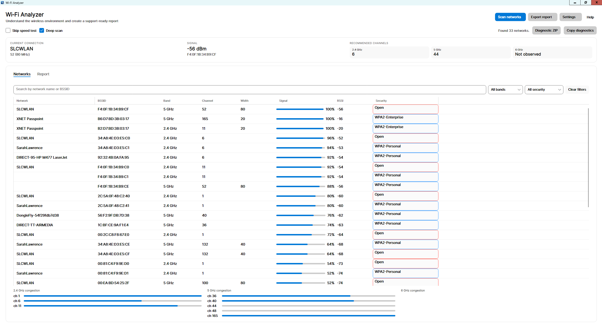
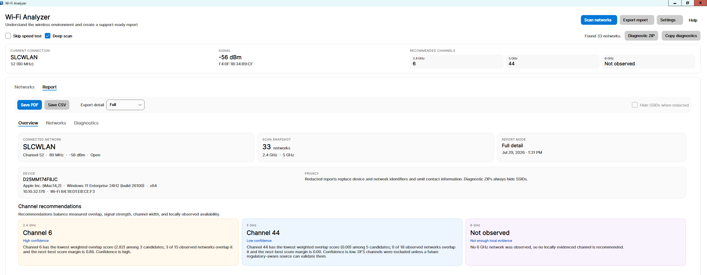
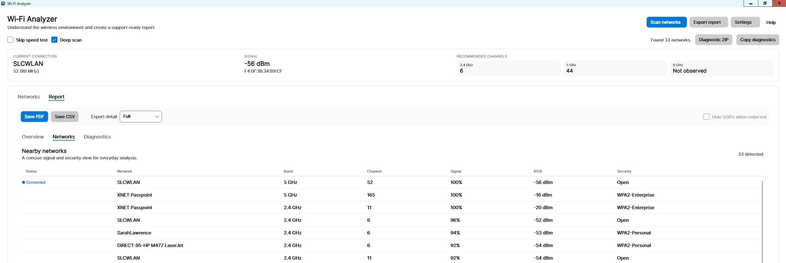
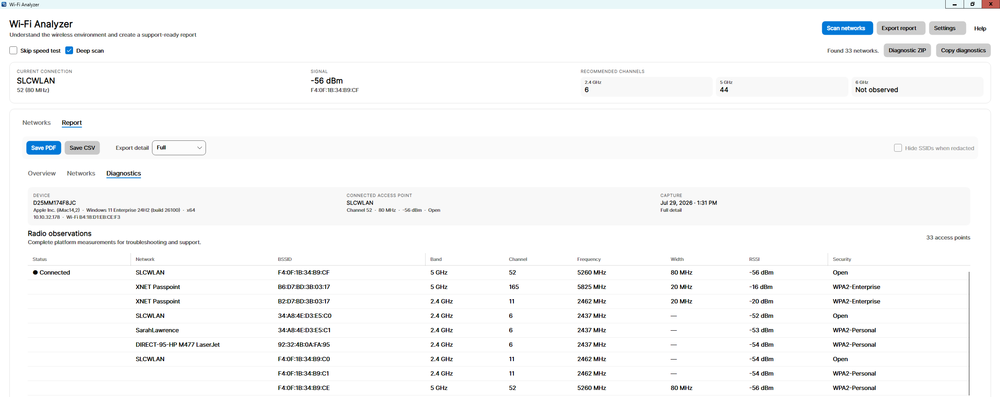
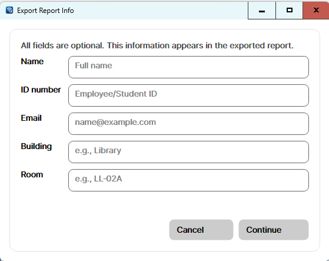
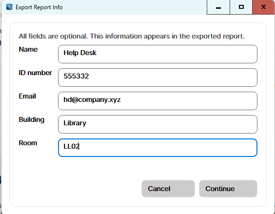
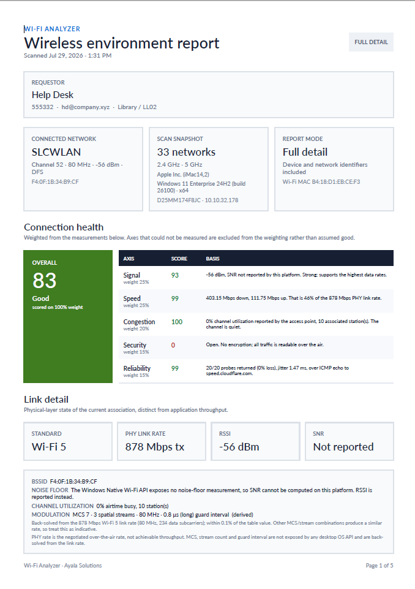
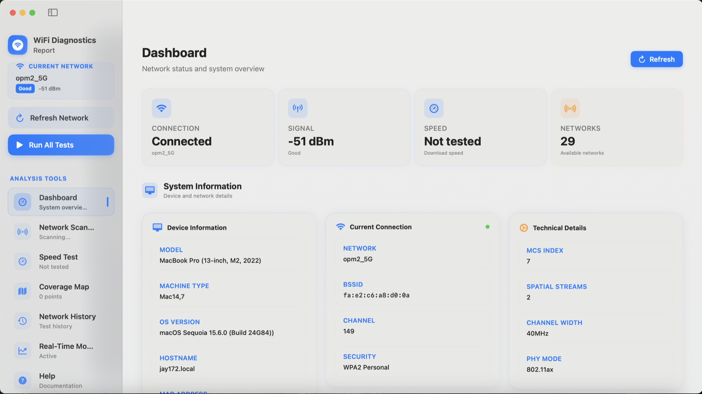
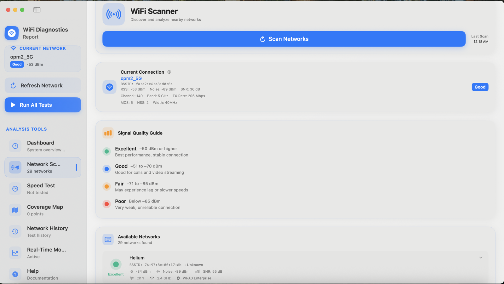
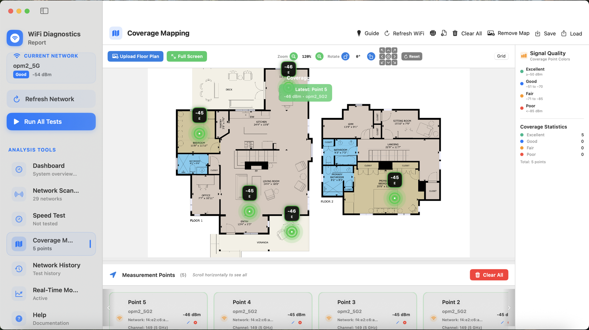

# 📡 Wi-Fi Analyzer

**Cross-platform Wi-Fi analysis, diagnostics, channel intelligence, and support-ready reporting for Windows, macOS, and Linux.**

Wi-Fi Analyzer examines the local wireless environment, evaluates connection health, identifies likely Wi-Fi problems, and generates structured reports an IT support team can act on. It is built with **Avalonia and .NET 8** and uses the best Wi-Fi information each operating system exposes.

**Current version: 2.6.4** · [Release notes](https://github.com/hov172/WinWiFiAnalyzer/releases)



## 🌐 Get the right app for your platform

Wi-Fi Analyzer is one of several Wi-Fi diagnostic tools built for IT support, Help Desk troubleshooting, network analysis, and end-user diagnostics. Each platform has its own implementation because Windows, macOS, Linux, and iOS expose different wireless information.

| Platform | App | Get it |
| --- | --- | --- |
| 🪟 **Windows 10/11 x64** | Wi-Fi Analyzer (this repository) | [EXE](https://github.com/hov172/WinWiFiAnalyzer/releases/latest/download/WifiAnalyzer-Windows-x64.exe) · [ZIP](https://github.com/hov172/WinWiFiAnalyzer/releases/latest/download/WifiAnalyzer-Windows-x64.zip) |
| 🍎 **macOS 11+, Apple silicon** | Wi-Fi Analyzer (this repository) | [DMG](https://github.com/hov172/WinWiFiAnalyzer/releases/latest/download/Wi.Fi.Analyzer-Apple-Silicon.dmg) · [ZIP](https://github.com/hov172/WinWiFiAnalyzer/releases/latest/download/Wi.Fi.Analyzer-Apple-Silicon.zip) |
| 🍎 **macOS 11+, Intel** | Wi-Fi Analyzer (this repository) | [DMG](https://github.com/hov172/WinWiFiAnalyzer/releases/latest/download/Wi.Fi.Analyzer-Intel.dmg) · [ZIP](https://github.com/hov172/WinWiFiAnalyzer/releases/latest/download/Wi.Fi.Analyzer-Intel.zip) |
| 🐧 **Linux x64 / ARM64** | Wi-Fi Analyzer (this repository) | [x64 tar.gz](https://github.com/hov172/WinWiFiAnalyzer/releases/latest/download/WifiAnalyzer-Linux-x64.tar.gz) · [ARM64 tar.gz](https://github.com/hov172/WinWiFiAnalyzer/releases/latest/download/WifiAnalyzer-Linux-arm64.tar.gz) |
| 🍎 **macOS, native with coverage mapping** | WiFi Diag Report | [GitHub](https://github.com/hov172/WifDiagReport) |
| 📱 **iOS / iPadOS** | WifiDiag beta | [TestFlight](https://testflight.apple.com/join/hDPGsHzd) |
| 🖥️ **PowerShell** | PS Wi-Fi Analyzer | [GitHub](https://github.com/hov172/PS_WI-FI_Analyzer) |

Wi-Fi Analyzer downloads are self-contained with the .NET runtime bundled. Windows is a single executable and SmartScreen may ask for confirmation on first launch. macOS builds are Developer ID signed and notarized; drag to Applications. Linux needs NetworkManager; extract and run `WifiAnalyzer`. Asset names are stable across releases, so these links always fetch the newest build, and versioned history is on the [Releases](https://github.com/hov172/WinWiFiAnalyzer/releases) page.

| Platform | Wi-Fi scanner | Requirements |
| --- | --- | --- |
| **Windows 10/11** | Native Wi-Fi API with `netsh` fallback | WLAN AutoConfig, enabled Wi-Fi adapter, location access |
| **macOS 11+** | CoreWLAN with structured `system_profiler` fallback | Wi-Fi and Location Services |
| **Linux** | `nmcli` with `iw` for additional link detail | NetworkManager and permission to query Wi-Fi |

The most recently documented real-hardware macOS validation is **2.6.4 on Apple silicon running macOS 27.0**: Location Services grant, full SSID and BSSID identifiers, scans, the speed test running after the scan with its results on the Overview tab, access-point ranking, the diagnostic summary, and PDF export. The directed switch needs a network with two visible radios and has not yet been exercised on real hardware.

Screenshots of the macOS and iOS companion apps are in [Companion apps](#-companion-apps).

---

## 🎯 What it does

Wi-Fi Analyzer is for IT professionals, Help Desk technicians, desktop support teams, network administrators, students, and power users who need to answer the questions a technician actually asks:

* Which access point is the device connected to, and how strong is the link?
* Is the channel congested, and is another channel measurably better?
* What Wi-Fi generation and physical link rate were negotiated?
* Are stronger roaming candidates visible? Is DFS in use? What roaming capabilities are advertised?
* Is performance consistent with the radio conditions?
* Which measurements came from the operating system, which were derived, and which were unavailable?
* Can the results be sent to IT without exposing identifiers?

In one scan the application combines Wi-Fi scanning, radio analysis, connection-health scoring, network performance testing, channel recommendations, system information, privacy-aware reporting, and command-line automation.

### A scan in five steps

1. Select **Scan networks**. The status panel reads **Scanning the Wi-Fi environment**, then **Measuring connection speed**, then offers to export a PDF.
2. Review nearby networks, per-band congestion, and the channel recommendations on the **Networks** tab.
3. Open **Access points** to see the ranked radios serving your network, try **Switch to this AP** where supported, or **Monitor roaming**.
4. Open **Report** for the diagnostic summary, the connection-health score, and the full radio detail.
5. Choose a privacy level and export the PDF or CSV.

---

## 🖼️ Screenshots

### Networks workspace

Interactive access to scan results with network, band, and security filtering, connected-AP identification, signal and channel information, and per-band congestion charts.


### Report: Overview

A high-level summary of the connection, device, system, scan scope, privacy mode, speed test (download, upload, latency, and probe quality), diagnostic summary, connection health, and channel recommendations with their confidence and rationale.



### Report: Networks

The concise day-to-day Wi-Fi list used during troubleshooting.



### Report: Diagnostics

The detailed radio-observation table: BSSID, frequency, channel, channel width, RSSI, connected AP, and additional radio information.



### Export report information

Before exporting a PDF or CSV, the application can collect optional requestor details: name, ID number, email, building, and room. Every field is optional. When included, they appear in the report header and are omitted from redacted reports.

| Empty | Completed |
| --- | --- |
|  |  |

### PDF report

The exported PDF can contain requestor information, connection and scan snapshots, device and system information, the connection-health score with the measurements behind each axis, physical-layer information, nearby network analysis, channel recommendations, and diagnostic information.



---

## 🚀 Features in depth

### 📡 Wi-Fi environment scanner

Scans nearby wireless networks across 2.4 GHz, 5 GHz, and observed 6 GHz networks.

Collected information can include SSID, BSSID, RSSI, signal quality, channel, channel width, frequency, security, Wi-Fi band, connected AP status, Wi-Fi generation, channel utilization, and roaming capabilities.

The application identifies the currently connected access point when the operating system provides enough information to determine its BSSID.

### 🩺 Diagnostic summary

Every scan names the likely issue in plain language, with one recommended next step, and a technician detail with the supporting and positive findings:

* Weak Wi-Fi association
* Packet loss
* High latency or high jitter
* Congested channel
* Possible sticky-client behavior
* No obvious problem

An open network is noted as an extra finding, never as the likely issue. Redacted reports keep only the plain-language summary; it never names the network or an access point.

### 📍 Access points and directed selection

The **Access points** tab ranks every radio serving the connected network with a 0–100 score and the reasons behind it. Statuses are CURRENT, RECOMMENDED, AVAILABLE, WEAK and INCOMPATIBLE. A radio is recommended only when it is at least 10 dB stronger, uses the same security mode, its channel is under 60 % airtime utilization, and its score beats the current access point. A stronger radio on a busy channel is shown as available, not recommended. Metrics the platform did not report are unknown, never zero.

**Switch to this AP** asks the operating system for that one access point and then verifies what the adapter actually did: connected and verified, connected to a different access point, failed with the OS error, or timed out. Signal, PHY rate and latency before and after are shown as observations, not verdicts.

| Platform | Directed selection |
| --- | --- |
| Windows | Native Wi-Fi API with the saved profile of the current network and one desired BSSID; the driver may still choose another |
| macOS | CoreWLAN, open networks only, because the app holds no credentials for secured ones; Location Services needed to confirm the BSSID |
| Linux | Not supported; manual steps are shown |

A directed request is a preference the driver may override. It is never a permanent lock.

**Monitor roaming** records every access-point change under the same network with the signal before and after, up to 100 events. The OS never reports why it roamed; only changes the app requested are attributed.

### 📊 Radio engineering detail

Depending on platform capabilities, the application can analyze:

* **PHY link rate.** Negotiated transmit and receive PHY rates where available, kept separate from application-level throughput so the two are not confused.
* **Wi-Fi standard.** Access-point capabilities can identify Wi-Fi 4, 5, 6, 6E, and 7.
* **Noise and SNR.** Noise floor and signal-to-noise ratio where the operating system exposes them. If the platform cannot provide these values, they are reported as **unmeasured** rather than estimated.
* **MCS.** Modulation and Coding Scheme information when reported or when it can be derived from available link information.
* **Spatial streams.** Describes the MIMO configuration being used by the connection.
* **Channel width.** Distinguishes connections at 20, 40, 80, and 160 MHz.
* **Guard interval.** Displayed where available or derivable.

### 📶 Channel utilization and congestion

Congestion is evaluated using more than the number of visible networks. Where beacon information is available, the application decodes the **BSS Load** element and reports measured channel utilization: the percentage of airtime the access point reports as busy.

That is considered alongside nearby AP count, RSSI, channel overlap, band, and channel width, which gives better evidence for channel recommendations than counting nearby SSIDs.

### 🧠 Channel recommendations

Recommendations are based on actual scan evidence and include the recommended channel, band, congestion evidence, signal overlap, confidence, and a plain-language rationale, so technicians understand **why** a channel is being recommended rather than receiving an unexplained number.

### 🛰️ Roaming analysis

For the connected SSID, the application identifies potential roaming candidates with their RSSI, signal difference from the current AP, and advertised 802.11k, 802.11v, and 802.11r support. This helps identify environments where a client remains associated with a weaker AP even though stronger candidates are visible.

### 🌦️ DFS analysis

Access points operating on DFS channels are identified. Rather than simply flagging DFS, the application explains the potential trade-offs and evaluates whether measured congestion may justify its use, giving context for channel selection, radar-sensitive channels, congestion, and available alternatives.

### ❤️ Connection health score

An overall connection-health score from **0–100** evaluates signal, speed, congestion, wireless security, and reliability. The application shows the measurement behind each scoring axis.

Unavailable measurements are **not assumed to be good**. If a value cannot be measured it is marked **unmeasured**, excluded from the health weighting, and the remaining measurements are reweighted. If less than half of the normal weighting is available, the score is marked **Provisional**. This prevents missing measurements from artificially improving a score.

### 💻 System and device information

Each scan captures support-relevant computer information: computer model, operating system, OS version and build, architecture, hostname, IP address, and Wi-Fi interface address. This is incorporated into support reports where appropriate.

### 🌐 Network performance testing

The graphical application runs a network performance test as part of every scan unless **Skip speed test** is checked. While it runs, the status panel reads **Measuring connection speed**. The results appear on the Report **Overview** tab as soon as the test finishes and are included in the text report, the PDF, and the connection-health score. An export reuses the scan's measurement rather than running the test again.

Measurements can include download throughput, upload throughput, latency, jitter, and packet loss.

Throughput is measured over timed windows with several TCP connections in parallel (six for download, four for upload). The connection ramp-up is excluded, upload chunks are sized adaptively, and only data the server acknowledged is counted. The nearest server is chosen by probe latency from Apple's network-quality endpoints, Cloudflare, or the custom endpoint configured in **Settings**.

Deep scanning and speed testing are enabled by default in the graphical application. The command-line interface behaves differently by design: network performance testing is opt-in so an automated or headless scan does not transfer network-test data unless explicitly requested.

---

## 🔬 Measurement sources by platform

Wi-Fi capabilities vary significantly between operating systems. Wi-Fi Analyzer distinguishes between:

* **Reported values** — supplied directly by the operating system or driver
* **Derived values** — calculated from other available measurements
* **Unmeasured values** — unavailable from the current platform

| Detail | Windows | macOS | Linux |
| --- | --- | --- | --- |
| PHY link rate | Reported TX/RX | Reported TX | Reported TX/RX |
| Noise floor / SNR | Not exposed by OS | Reported | Reported when driver publishes it |
| MCS / Streams / Guard Interval | Derived from link rate | Derived from link rate | Reported by `iw` |
| Wi-Fi Standard | Beacon decoding | Reported/available platform detail | Reported/available platform detail |
| Channel Utilization | Beacon decoding | Limited by platform | Limited by platform |
| 802.11k/v/r | Beacon decoding | Limited | Limited |

The report identifies the source so a derived value is never presented as though it were a direct driver measurement. The diagnostic workflow is the same on every operating system, while controls, fonts, window chrome, and permission prompts follow the native host environment.

---

## 🔐 Privacy and redaction

Wi-Fi Analyzer was designed so diagnostic information can be shared with support teams without unnecessarily exposing identifiers.

**Full reports** can contain the device and network identifiers visible to the application.

**Redacted reports**:

* Replace computer names with aliases
* Replace BSSIDs with per-export salted aliases
* Mask IP addresses
* Mask Wi-Fi interface addresses
* Omit saved contact information
* Can hide SSIDs
* Hash the BSSIDs in the Directed AP test and Roaming events with the same aliases, scrub OS error text, and drop the technician diagnosis

Computer model, operating-system version, and architecture remain because they can be necessary for compatibility diagnosis.

**Diagnostic ZIP** files are **always redacted** and always hide SSIDs. They contain only whitelisted application information, settings, scan information, and bounded sanitized logs.

See [docs/PRIVACY.md](docs/PRIVACY.md) for the complete field-level privacy policy.

---

## ⌨️ Command-line interface

The CLI performs the same multi-pass Wi-Fi scan used by the graphical application and can generate the same report formats. Published executables support the same arguments.

```bash
# Basic scan, text report to stdout
WifiAnalyzer --cli

# PDF and CSV export
WifiAnalyzer --cli --pdf report.pdf --csv networks.csv --quiet

# Redacted report
WifiAnalyzer --cli --redacted --hide-ssids --pdf redacted.pdf

# Filtered scan
WifiAnalyzer --cli --match lobby --band 5 --security wpa3 --csv filtered.csv
```

| Option | Description |
| --- | --- |
| `--cli` | Scan and write the text report to stdout |
| `--pdf <path>` | Generate PDF report |
| `--csv <path>` | Generate network CSV |
| `--quiet` | Suppress text output during export |
| `--redacted` | Replace device/network identifiers with aliases |
| `--hide-ssids` | Mask SSIDs; requires redacted mode |
| `--speed-test` | Measure throughput, latency, jitter, and loss |
| `--deep-scan` | Enable deep scanning |
| `--no-deep-scan` | Disable deep scanning |
| `--name` | Requestor name |
| `--id` | Requestor ID |
| `--email` | Requestor email |
| `--building` | Building |
| `--room` | Room |
| `--match <text>` | Filter listed SSID/BSSID values |
| `--band <2.4\|5\|6>` | Filter listed networks by band |
| `--security <open\|wpa2\|wpa3>` | Filter listed networks by security |
| `--help` | Display all available options |

| Exit code | Meaning |
| --- | --- |
| `0` | Success |
| `1` | Failure or invalid arguments |
| `2` | `--require-network` specified but no networks found |
| `130` | Operation cancelled |

Arguments are validated before accessing the Wi-Fi radio.

---

## 📚 Documentation and product information

* [docs/USER_GUIDE.md](docs/USER_GUIDE.md) — Usage, navigation, permissions, reports, and troubleshooting
* [docs/PRIVACY.md](docs/PRIVACY.md) — Field-level privacy and redaction behavior
* [docs/TEST_MATRIX.md](docs/TEST_MATRIX.md) — Testing coverage and platform validation
* [Releases](https://github.com/hov172/WinWiFiAnalyzer/releases) — Version history and release notes

| | |
| --- | --- |
| **Product** | Wi-Fi Analyzer |
| **Version** | 2.6.4 |
| **Publisher** | Ayala Solutions |
| **Framework** | Avalonia / .NET 8 |
| **Platforms** | Windows x64 / ARM64 · macOS Intel / Apple silicon · Linux x64 / ARM64 |

---

## 🖼️ Companion apps

Links for every platform are in the table at the [top](#-get-the-right-app-for-your-platform).

### macOS: WiFi Diag Report

A native macOS companion: a dashboard with device and link details, a network scanner with a signal quality guide, and floor-plan coverage mapping with per-point signal readings.

| Dashboard | Network Scanner |
| --- | --- |
|  |  |



### iOS and iPadOS: WifiDiag beta

WifiDiag maps coverage on the device: scan the room with RoomPlan or import a floor plan, align it, then walk the space while the AR heatmap builds from live readings.

| RoomPlan scan | Floor plan alignment | AR heatmap |
| --- | --- | --- |
|  |  |  |

---

## ⭐ Support the project

If Wi-Fi Analyzer helps with your Wi-Fi troubleshooting or IT support workflow, consider giving the project a ⭐ on GitHub.

Feedback, bug reports, feature requests, testing, and contributions help improve the Windows, macOS, Linux, PowerShell, and iOS/iPadOS Wi-Fi diagnostic tools.
